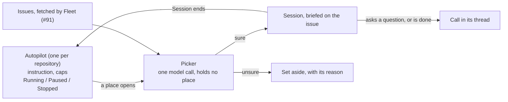

# Autopilot: a repository works its own backlog

You start Autopilot on a repository at 11pm with one sentence: *"work through
the open issues that don't need design decisions, two at a time, until 7am."*
In the morning the clear ones ran and wait for you or landed, the ones it was
unsure of sit on a pile with its reason, and nothing ran past the caps you set.

**This is the scope's whole promise run without a person at the dispatch.**
Every pick is an ordinary Session, briefed on its issue and on the workflow the
picker chose, so the only thing Autopilot adds is the choosing, the bounds and
the off switch. Since the 15 Oct 2026 decision to fold Jobs into Sessions
(`.claude/decisions/2026-10-15-sessions-absorb-jobs.md`).

## It is a record that starts Sessions

| Shape | Why not |
|---|---|
| A Session runs the queue | A conversation in the middle is the third attempt `docs/scope.md` records as abandoned. A Session is not waited on by Fleet |
| One endless parent that waits | A parent that waits holds a place, the deadlock `epic-as-one-job.md` names |
| **A Fleet record that starts Sessions** | Fleet does what is deterministic: counting, caps, Pause and Stop. An agent does what needs judgement, in a Session that ends. Everything that changes code is a Session |

**Flexible work is a workflow, not a different kind of runner.** The picker
chooses each Session's workflow the way the [Job proposer](../concepts/job-proposer.md)
does. Work whose shape is unknown gets a workflow that plans first.

## What a person sets

| Setting | Notes |
|---|---|
| Instruction | Plain words. The picker reads it; Fleet never parses it |
| At once | How many of its Sessions may run together |
| Until | A time. Optional |
| Spend | A dollar total across its Sessions. Optional |
| Jobs | How many Sessions it may start. Optional. Named for the Jobs it once started |

> **Rule.** Each cap stops the next pick and never a running Session.
> Why: a Session's cost arrives as it works. A cap that read as "spending stops
> here" would be believed.

The first cap reached
pauses Autopilot and says which one it was; raising it lets Resume carry on (#2105).

## What happens to a pick

| Case | What happens |
|---|---|
| The picker is sure | The Session starts with no one asked (`2026-10-11-autopilots-clear-picks-start-unasked.md`) |
| The picker is unsure, for instance whether it needs a design call | Set aside with the reason, and the next issue is taken. The queue never waits on it |
| The Session asks a question | The Session gives its place back and waits for the answer (`2026-10-11-a-job-waiting-on-him-gives-its-place-back.md`), as a call in its thread |

> **Rule.** Only Autopilot's sure picks start with no person pressing.
> Why: the owner narrowed his reading of every dispatch for Autopilot alone on
> 11 Oct 2026. A Session has no dispatch gate, so a pick it is unsure of waits
> on the pile for his press instead.

## Pause and Stop

| Act | New picks | Started Sessions | Picked, not run | Autopilot |
|---|---|---|---|---|
| Pause | None | Carry on | Stay | Resumes where it was |
| A cap reached | None | Carry on | Stay | Paused, naming the cap. Resumes once the cap is raised |
| Stop | None | Carry on | Withdrawn, closed | Ends |

Neither one stops a Session that is working.
`2026-10-11-pause-drains-stop-withdraws.md`.

## Where it stands

| Part | State |
|---|---|
| The decisions | Taken, `.claude/decisions/2026-10-11-*.md` |
| A waiting Session gives its place back | Built: a Session with a call standing for the person, or one that has replied or gone idle, holds no place |
| Fleet reads issues and writes back | Built, #91: `docs/concepts/tracker.md`. The list is in the composer; the Cockpit lane is Autopilot's |
| The Autopilot record, caps, picker, Pause and Stop | Built, #2092's Fleet half: [`../concepts/autopilot.md`](../concepts/autopilot.md). The picker is one model call made the way the Job proposer's is, not a Drone. A Session waiting on a person, or idle, holds no place |
| The set-aside pile's acts | Built: a person dispatches a pick, which starts a Session, or dismisses it |
| The acceptance test | `crates/acceptance/tests/autopilot.rs`, passing |
| The Cockpit lane | Built, #2092's Bridge half, and #2105's quotes, cap pause, Edit caps and All line (the All line since replaced by the header control that asks for a repository): [`../concepts/autopilot.md`](../concepts/autopilot.md), *In Bridge* |

## What it depends on

- `../concepts/fleet.md` — admission, the concurrency bound, and the dispatch gate.
- `epic-as-one-job.md` — a Drone that dispatches Jobs, and a waiting parent that holds nothing.
- `../concepts/judge.md` — what a refusal is, and who hears it.
- `../concepts/job-proposer.md` — choosing a workflow from a request.
