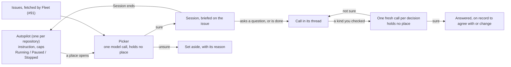

# Autopilot: a repository works its own backlog

You start Autopilot on a repository at 11pm with one sentence: *"work through
the open issues that don't need design decisions, two at a time, until 7am."*
In the morning the clear ones ran and wait for you or landed, the ones it was
unsure of sit on a pile with its reason, and nothing ran past the caps you set.
The questions, plans and drafts you let it answer are answered and on record with
what it chose and why, and you agree with each or change it.

**This is the scope's whole promise run without a person at the dispatch.**
Every pick is an ordinary Job, briefed on its issue and on the workflow the
picker chose, so the only thing Autopilot adds is the choosing, the bounds and
the off switch. `.claude/decisions/2026-10-15-sessions-absorb-jobs.md`.

## It is a record that starts Jobs

| Shape | Why not |
|---|---|
| A Job runs the queue | A conversation in the middle is the third attempt `docs/scope.md` records as abandoned. A Job is not waited on by Fleet |
| One endless parent that waits | A parent that waits holds a place, which is the deadlock |
| **A Fleet record that starts Jobs** | Fleet does what is deterministic: counting, caps, Pause and Stop. An agent does what needs judgement, in a Job that ends. Everything that changes code is a Job |

**Flexible work is a workflow, not a different kind of runner.** The picker
chooses each Job's workflow the way the [Proposer](../concepts/job-proposer.md)
does. Work whose shape is unknown gets a workflow that plans first.

## It answers what you checked, and keeps what it answered

| Shape | Why not |
|---|---|
| A helper agent that stays up while you are away | An orchestrator that holds a conversation is the third attempt `docs/scope.md` records as abandoned, and it would hold a place |
| Every decision answered, or none | A person who is away wants a plan approved and a destructive command left alone |
| **One fresh call per decision, per repository** | It reads the instruction and that repository's earlier answers from the record, names a way and says whether it is sure, and ends. No clear answer means it waits for you |

You check at start what goes on autopilot, the backlog and Jobs already running, and which kinds of decision it may answer:
a question with or without a recommended answer, a plan, a draft, a walk, landing a green pull request, an issue it was unsure of, fixing a red main, Reads and Writes.
Run commands count as Writes.

> **Rule.** A destructive decision always waits, and so does a Job in a terminal and a command Fleet cannot read.
> Why: a held decision costs a glance. A terminal's own prompt is answered in the terminal, and Fleet answers only what it can read whole.

A red main starts one Job, once for each red commit, with no call.
Each answer is on record with what was chosen and why, in a list of its own, opened from a lamp on the switch's plate, where you Agree, Change it by sending the Job a correction, or open the Job.
Autopilot keeps running when you come back: the first press or key after ten minutes with neither asks whether to keep it on or turn it off.

## What a person sets

| Setting | Notes |
|---|---|
| Instruction | Plain words. The picker reads it; Fleet never parses it |
| At once | How many of its Jobs may run together |
| Until | A time. Optional |
| Spend | A dollar total across its Jobs. Optional |
| Jobs started | How many Jobs it may start. Optional |
| On autopilot | The backlog, Jobs already running, or both |
| Decisions | The kinds it may answer |

The caps and the boxes are set at start. While it runs the switch is the only control: Bridge has no Pause, Resume or editing of caps.

> **Rule.** Each cap stops the next pick and never a running Job.
> Why: a Job's cost arrives as it works. A cap that read as "spending stops
> here" would be believed.

The first cap reached
pauses Autopilot and the setup says which one it was beside Start, which begins it again (#2105).

## What happens to a pick

| Case | What happens |
|---|---|
| The picker is sure | The Job starts with no one asked (`2026-10-11-autopilots-clear-picks-start-unasked.md`) |
| The picker is unsure, for instance whether it needs a design call | Set aside with the reason, and the next issue is taken. The queue never waits on it |
| The Job asks a question | The Job gives its place back and waits for the answer (`2026-10-11-a-job-waiting-on-him-gives-its-place-back.md`), as a call in its thread |

> **Rule.** Only Autopilot's sure picks start with no person pressing.
> Why: the owner narrowed his reading of every dispatch for Autopilot alone on
> 11 Oct 2026. A Job has no dispatch gate, so a pick it is unsure of waits
> on the pile for his press instead.

## Pause and Stop

| Act | New picks | Started Jobs | Picked, not run | Autopilot |
|---|---|---|---|---|
| Pause | None | Carry on | Stay | Resumes where it was |
| A cap reached | None | Carry on | Stay | Paused, naming the cap. Resumes once the cap is raised |
| Stop | None | Carry on | Withdrawn, closed | Ends |

Neither one stops a Job that is working.
Bridge draws the switch alone: it is Stop, and Start begins a stopped or paused one again.
`2026-10-11-pause-drains-stop-withdraws.md`.

## Where it stands

| Part | State |
|---|---|
| The decisions | Taken, `.claude/decisions/2026-10-11-*.md` |
| A waiting Job gives its place back | Built: a Job with a call standing for the person, or one that has replied or gone idle, holds no place |
| Fleet reads issues | Built, #91: `docs/concepts/tracker.md`. Fleet never comments on or labels the issue. The list is in the composer; the Cockpit lane is Autopilot's |
| The Autopilot record, caps, picker, Pause and Stop | Built, #2092's Fleet half: [`../concepts/autopilot.md`](../concepts/autopilot.md). The picker is one model call made the way the Proposer's is, not an agent. A Job waiting on a person, or idle, holds no place |
| The set-aside pile's acts | Built: a person dispatches a pick, which starts a Job, or dismisses it |
| The acceptance test | `crates/acceptance/tests/autopilot.rs`, passing |
| The Cockpit lane | Built, #2092's Bridge half, and #2105's quotes and cap pause: [`../concepts/autopilot.md`](../concepts/autopilot.md), *In Bridge*. The switch on the Map's lip, the setup, and the list of answers replaced Pause, Resume and Edit caps |
| The decisions | Built: [`../concepts/autopilot.md`](../concepts/autopilot.md), *How a decision happens* |

## What it depends on

- `../concepts/fleet.md` — the limits Fleet keeps.
- `../concepts/judge.md` — what a refusal is, and who hears it.
- `../concepts/job-proposer.md` — choosing a workflow from a request.
