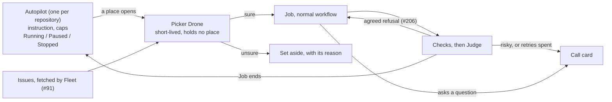

# Autopilot: a repository works its own backlog

You start Autopilot on a repository at 11pm with one sentence: *"work through
the open issues that don't need design decisions, two at a time, until 7am."*
In the morning the clear ones ran and wait at review or landed, the ones it was
unsure of sit on a pile with its reason, and nothing ran past the caps you set.

**This is the scope's whole promise run without a person at the dispatch.**
Every pick is an ordinary Job — a workflow, a worktree, Checks, a Judge — so
the only thing Autopilot adds is the choosing, the bounds and the off switch.

## It is neither a Session nor a Job

| Shape | Why not |
|---|---|
| A Session runs the queue | A conversation in the middle is the third attempt `docs/scope.md` records as abandoned. A Session is not gated, judged or waited on by Fleet |
| One endless parent Job, like an Epic | A Job ends, and `iteration_cap` bounds an Epic's loop. A parent that waits holds a place, the deadlock `epic-as-one-job.md` names |
| **A Fleet record that dispatches Jobs** | Fleet does what is deterministic: counting, caps, Pause and Stop. A Drone does what needs judgement, in a run that ends. Everything that changes code is a Job |

**Flexible work is a workflow, not a different kind of runner.** The picker
chooses each Job's workflow the way the [Job proposer](../concepts/job-proposer.md)
does. Work whose shape is unknown gets a workflow that plans first.

## What a person sets

| Setting | Notes |
|---|---|
| Instruction | Plain words. The picker reads it; Fleet never parses it |
| At once | How many of its Jobs may run together |
| Until | A time. Optional |
| Spend | A dollar total across its Jobs. Optional |
| Jobs | How many it may start. Optional |

> **Rule.** Each cap stops the next pick and never a running Job.
> Why: a Job's cost arrives when its Drone ends, the reason #51's cap refuses the
> next dispatch. A cap that read as "spending stops here" would be believed.

The per-Job ceilings of #51 still hold under all of these. The first cap reached
stops Autopilot picking and says which one it was.

## What happens to a pick

| Case | What happens |
|---|---|
| The picker is sure | The Job starts with no approval (`2026-10-11-autopilots-clear-picks-start-unasked.md`) |
| The picker is unsure, for instance whether it needs a design call | Set aside with the reason, and the next issue is taken. The queue never waits on it |
| The Job's Drone asks a question | The Job gives its place back and waits for the answer (`2026-10-11-a-job-waiting-on-him-gives-its-place-back.md`) |
| The Judges agree it needs redoing | It goes back to the Drone, twice at most (#206) |
| The Judges call it risky, or the retries are spent | A call card, as any refusal is today |

> **Rule.** The dispatch gate is skipped for Autopilot's sure picks and nowhere else.
> Why: the owner reads every plan he dispatches (3 Sep 2026), and narrowed that
> for Autopilot alone on 11 Oct 2026. A Job dispatched by hand still waits at
> `awaiting_approval`.

## Pause and Stop

| Act | New picks | Started Jobs | Picked, not started | Autopilot |
|---|---|---|---|---|
| Pause | None | Finish | Stay | Resumes where it was |
| Stop | None | Finish | Withdrawn | Ends |

Neither one stops a Job that is spending. That is the Job's own Pause.
`2026-10-11-pause-drains-stop-withdraws.md`.

## Where it stands

| Part | State |
|---|---|
| The decisions | Taken, `.claude/decisions/2026-10-11-*.md` |
| A waiting Job gives its place back | Not built |
| An agreed refusal goes back to the Drone | Not built, #206 |
| Fleet reads issues and writes back | Not built, #91 |
| The Autopilot record, caps, picker, Pause and Stop | Not built |
| The Cockpit lane | Not built |

## What it depends on

- `../concepts/fleet.md` — admission, the concurrency bound, and the dispatch gate.
- `epic-as-one-job.md` — a Drone that dispatches Jobs, and a waiting parent that holds nothing.
- `../concepts/judge.md` — what a refusal is, and who hears it.
- `../concepts/job-proposer.md` — choosing a workflow from a request.
