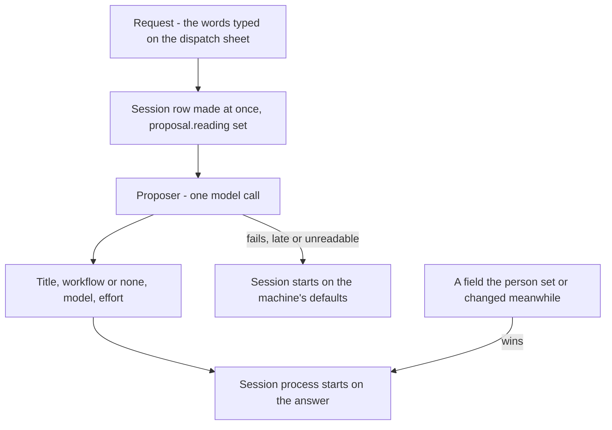

# Proposer

**What it is:** The model call that reads the request a Job is started with and proposes its title, which workflow it should follow or none, its model and its effort.
Proposes only; whatever the person set wins.

---

**Kind:** Policy.

Formalises the proposer. Its rules lived across [Manifest](manifest.md), [Workflow](workflow.md), [Fleet](fleet.md) and [Job](session.md); this document is their home and those pages link here.

**A Policy gets a document when it needs a name and a single owner, not an ID** — the same reason [Judge](judge.md) has one while being a Policy rather than a domain object.

## What it is

One model call at a Job's start. It reads the request the person typed and **proposes four things**; none of them is an act.

**It is a Policy rather than an Agent** — no toolset, no worktree, no job, no ability to transition anything.
See `../contracts/system-architecture.md`. [Fleet](fleet.md) makes the call and reads the answer.

**It is a cheap model call with a bounded question.** It is not a job or an agent, and it starts nothing: the Job's process starts when the answer lands, or when the call fails.

**It is called the proposer, always.** The classifier and the shape classifier are retired. See `../contracts/design-system.md` lexicon.

## Why it exists

**So that starting a Job is describing the work, not filling in a form.** A request arrives as words.
Someone has to decide what kind of work it is, which workflow fits, which model and how hard it should think.
Doing that by hand means knowing the workflow catalogue before you can ask for anything.

> **Rule.** There is no hand-entry form. Describing the work is the only way a person starts a Job from Bridge, and a decision the proposer would take is overridden in the Job's own panel.
> Why: the owner, 23 September 2026 — *"I think with all of the settings, this is really not needed anymore."*

## What it proposes

| Output | Detail |
| --- | --- |
| `workflow` | One id from the catalogue, or `none` |
| `title` | What the Job is called, in a few of the words the request used, cut to 80 characters |
| `model` | Which model the Job runs as, picked from what this machine holds |
| `effort` | `low`, `medium` or `high`, by how hard the work reads |

**The model and effort go on one line of the answer.** A small change to a file the request names wants the lightest model and the lowest effort; work across many files, a design or a hard diagnosis wants the strongest model and a higher effort.
The call leaves the pair out where it cannot tell.

**The model is picked from a list, never invented.** The question carries every model this machine can run and the answer names one of them.
A name this machine does not run leaves the field absent, and absent is the machine's own default, never a model this call picked.

**An effort the CLI does not take reads as absent in the same way,** and so does a blank title.

[Workflow](workflow.md) owns the workflow catalogue. A Job follows at most one, which the proposer picks and a person may change from the Job's panel.

**One call, because it is one reading.** Which workflow, what to call it, which model and how much effort answer the same question — *what is this work* — off the same input.

### When no workflow fits

**`none` is an answer, and the Job is a custom one.** The format asks for `none` rather than the nearest fit. No workflow is assigned by default.

Why: a Job started on a near miss would be held to steps that are not its work, and a soft rail laid down by a guess is worse than none.

**An id the repository does not hold reads as `none` too.**

**With `features.workflows` off, the proposer is shown no workflows.** It never picks one and still proposes the title, model and effort.

## What it reads

| Given | Detail |
| --- | --- |
| The request | Verbatim |
| The workflows this Manifest holds | Each one's id, name and step labels, and what requests it is for where the definition declares `for_requests` |
| The models this machine can run | By name |

**It is given nothing else.** Not the repository, not the `armada.yml`, not the Jobs already running.

Why: every extra token is money on a call that fires on every start, and a call that can reach the repository is an agent under another name.

**Step labels are how one workflow is told from another.** A name alone separates Bug from Revert and does not separate Feature from Refactor.

**`for_requests` is how a request is matched to a workflow at all.** Labels are in the workflow's own vocabulary, so they cannot say whether a request is this kind of work.
The line is written in a requester's words, rendered beside the labels rather than instead of them, and optional — a definition declaring none is shown by its id, name and labels alone.
`crates/core-model/domain/workflowdef-fields.toml` holds the field.

**Every workflow Armada ships declares one, read off its own judge criteria.** Decided 1 Oct 2026, after a request to retire a guide was proposed as Refactor and Refactor's judge refused the plan for changing what a person sees.
The labels had not said that a refactor promises no visible change; the line now does, and each line names what separates it from its nearest neighbour.
`crates/config/tests/shipped.rs` refuses a shipped definition without one.

## How a Job's request is read

**A Job is read once, and the press does not wait for it.** `StartSession.request` is the words the person typed at the dispatch sheet; a start with none is read at its first message (`session.md`, *A Job's proposal*, lists which).
Fleet makes the call on them, against the workflows and the models this machine runs, and the Job's process starts when the answer lands.
`crates/fleet/src/session_host/proposing.rs`; the answer format is `SESSION_ANSWER_FORMAT` in `crates/fleet/src/session_proposer.rs`.

| Line | Fills | Where it reads as none |
| --- | --- | --- |
| `workflow:` | The Job's `workflow`, one id from the catalogue | `none`, or an id the repository does not hold. **None is a custom Job, never a default workflow** |
| `title:` | The Job's title, cut to 80 characters | Absent: the request's first line |
| `settings:` `model=` | The Job's model | A name this machine does not run |
| `settings:` `effort=` | The Job's effort | A level the CLI does not take (`low`, `medium`, `high`) |

**What the person set wins.** A title, model or effort given on the start, or changed in a panel while the call was out, is left as it is.
Each field the proposer did fill is listed in the record's `proposal.picked` until the person changes that field.

**A failure starts the Job on the machine's defaults.** A call that fails, passes its budget or answers with no `workflow:` line is logged on Fleet's stderr and the Job starts as if no request had been given, with the first line of the request for a title.
Nothing is refused, and there is no second try: a Job is a person's own conversation, and a reading that lingers is worse than none.

**The prompt is a constant, not an editable setting.** It is one fixed question with three lines of answer. Revisit if one is wanted.

**It runs on every start from the sheet.** The call runs whether the repository holds one Workspace or several, so there is no case in which a person types the workflow instead of reading one.

**Cost accepted:** a cheap model call and its budget on every start. The press never waits on it, so the latency is the Job's process starting a moment later and no one's screen.

## What is recorded

**Its output is not stored as its own record.** `workflow`, `title`, `model` and `effort` land on the [Job](session.md), and `proposal.picked` names the fields the proposer filled until the person changes each.
No field says a proposal happened beyond that.

## Relationship to Helm

[Helm](helm.md) does the same reasoning more deliberately — the expensive end of a spectrum this covers cheaply by default.

|  | Proposer | Helm |
| --- | --- | --- |
| Runs | On every start from the sheet | On request |
| Budget | Tight | None |
| Model | `models.proposer` | Supplied by the caller |

It shares the `ModelClient` adapter with the [Judge](judge.md) — same client, different callers, model as a parameter.
