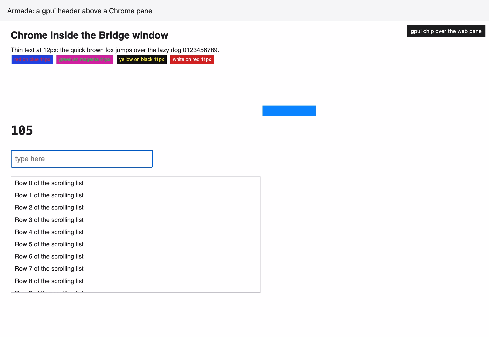

# Spike: Can Chrome draw inside a gpui window in the native Bridge?

**Answer: yes, by off-screen rendering into gpui's `surface`, so the glued window is not needed.**
Chrome (CEF 156) ran windowless, painted into a buffer, and gpui drew that buffer as one element between its own header and a chip laid over it, in the pinned `gpui-pre =0.3.11`.
It worked in a headless gpui window and in a real window under gpui's own `Application` run loop, with nothing on screen.
Because it worked, the child NSView and the glued window were not built, and what they would cost is argued from source only.

The price of this route is a conversion and a rebuild of input.
gpui's `surface` takes only a bi-planar 4:2:0 full-range CVPixelBuffer, and Chrome paints BGRA, so every frame is converted and the colour of small coloured text is smeared (*Colour*).
A windowless Chrome has no NSView, so VoiceOver sees nothing of the page until the accessibility tree Chrome hands over is mapped into gpui's (*Accessibility*).
Mouse, keys, scrolling and focus reach the page only as calls Bridge makes, which the spike showed working for one click, two characters and one wheel turn.

Measured on 9 Nov 2026 on an Apple M5 Pro, 18 cores, 48 GB, macOS 27.0.1, arm64.
The spike is `crates/bridge-native/examples/cef_spike/` on the branch `spike/native-bridge-chrome`, kept off `main` because it speaks unsafe.
It is a crate of its own that links the same gpui pins as Bridge; `cef` is in no `Cargo.toml` that Bridge builds.
`run.sh <scratch dir>` rebuilds it, lays out the app, runs it with no window and drives the page over CDP.
All timings are a debug build of gpui with the spike's own code at opt-level 3.

## What was tried

| Route | Result |
|---|---|
| 1. Off-screen rendering into `surface` | Works. Measured below |
| 2. A child NSView in gpui's window | Not built, because route 1 worked |
| 3. A glued borderless window | Not built, because route 1 worked |

## The numbers

| Measure | Result |
|---|---|
| `cef` crate cold build, debug, from an empty `target` | 59 s wall, 98 s of CPU, with the CEF download and the C++ wrapper build in it |
| `cef` crate cold build, release, helper binary only | 2 min 32 s |
| gpui, cef and the spike together, cold, debug | 61 s, with the CEF archive already downloaded |
| Rebuild after editing the spike | 3 s |
| CEF download | 135 MB (`minimal`, `macosarm64`, bz2), 339 MB unpacked |
| What the cef crate needs on the Mac | `cmake` and `ninja`. Neither is installed here; they came from a pip venv outside the repo |
| Chrome framework in the app | 327 MB: 228 MB the framework binary, 84 MB resources, 17 MB Libraries |
| Of the resources, locale folders | About 50 MB, none pruned. Pruned, the framework would be about 277 MB |
| Five helper apps | About 0.4 MB each, release and stripped, 2 MB in all. One binary copied five times |
| App bundle delta from Chrome | About 329 MB, 148 MB zipped |
| Chrome processes while one page is open | 5: GPU, network, storage, two renderers |
| Their resident memory, static page | About 500 MB; our own process added about 200 MB |
| CPU, static page, poll every 16 ms | Our process 1 to 3% of a core, each Chrome process under 2% |
| CPU, full-pane animation, ~42 paints a second | Our process 68 to 89% of a core in debug, with four conversion threads. Not split further |
| Paint rate on that animation | 35 to 44 a second at 2200 by 1424 pixels, with 60 asked for. The page's own `requestAnimationFrame` counted the same |
| CEF initialised, browser created | 125 to 176 ms after process start |
| First frame in gpui | 214 to 734 ms after process start, cold profile slowest |
| BGRA to NV12 of one frame, 2200 by 1424 | 1 thread 2.9 ms mean, 3.9 ms p95. 4 threads 0.9 to 1.1 ms mean, 1.1 to 1.8 ms p95 |
| New CVPixelBuffer per frame | 0.14 to 0.23 ms |
| Whole paint callback | 1.1 to 1.9 ms with 4 threads, 3.1 ms with 1 |
| gpui update and draw of a frame with the surface | 0.4 to 0.7 ms |
| `render_to_image` of the window, for a picture only | 125 to 146 ms |
| Resize to the first frame at the new size | 51 to 219 ms on the animated page, 306 to 355 ms on a static one at a 16 ms poll |

CPU came from `ps` over 1.5 s windows and, for the animated page, a `sample` of the main thread: 78% of it asleep, the rest mostly waiting on the conversion.

## CDP

**`remote_debugging_port` works, and the answer is a normal Chrome DevTools Protocol endpoint.**
`GET http://127.0.0.1:9333/json/version` answered 200 with `Browser: Chrome/156.0.8078.88`, `Protocol-Version: 1.3`, `V8-Version: 15.6.75.36` and a `webSocketDebuggerUrl`.
Chrome listens on 127.0.0.1 only.
`/json/list` named the one page target.
Over the page's WebSocket, `Runtime.evaluate` read the title, the user agent and a `devicePixelRatio` of 2, and changed the heading text, which showed in the next frame gpui drew.
`Page.captureScreenshot` returned a 106 KB PNG with no window anywhere.
The first answer came 1.7 s after launch with a client polling every 50 ms.
The spike sets `--remote-allow-origins=*`; running without it was not tried.

## Keyboard focus

**Focus between gpui and the page is Bridge's to manage, because the page has no NSView to take it.**
gpui keeps the first responder the whole time.
The spike called `set_focus(1)` on the browser host, sent a mouse click, then a raw key down, a char and a key up for each of `h` and `i`, and one wheel event of -240.
Over CDP the input held `"hi"` and the list's `scrollTop` was 240.
Not built: turning a gpui keystroke into Chrome's `windows_key_code` and mac key code, IME, modifiers, and calling `set_focus` when a gpui focus handle gains or loses focus.

## Colour

Chrome's pixels pass through 4:2:0 chroma subsampling on the way into `surface`, because `draw_surfaces` in `gpui-pre-apple` refuses any other pixel format (`kCVPixelFormatType_420YpCbCr8BiPlanarFullRange`).
The spike converts with BT.601 full range, the matrix `surface_fragment` inverts, and averages each 2 by 2 block for chroma.
Against Chrome's own BGRA for the static top band of the page, 2200 by 340 pixels:

| | Result |
|---|---|
| Mean channel error | 0.74 to 0.84 of 255 |
| Pixels off by more than 16 | 1.3 to 1.5% |
| Pixels off by more than 48 | 0.4 to 0.5% |

Black text on white is clean.
Small saturated text on a saturated ground is not: red on blue and green on magenta at 11 px go muddy.
Left is Chrome's pixels, right is what gpui drew.

Documents, sketch mocks and walks use Bridge's tokens, so most text will sit on near-white or near-black.
The error will show on coloured chips and syntax-highlighted code.
Two limits come from the same function: `surface.rs` leaves corner radii as a TODO, so a rounded pane needs a rect clip, and a CVPixelBuffer has no alpha, so Chrome has to paint on an opaque background.

## Accessibility

**Chrome delivers its accessibility tree to the host, and it never reaches VoiceOver without work.**
With `set_accessibility_state(ENABLED)`, `OnAccessibilityTreeChange` fired 51 to 73 times a run, 270 to 300 KB of JSON in all, 631 nodes in the first full tree (`rootWebArea`, `heading`, `staticText`, `inlineTextBox`), and the page's text in it.
Nothing is mapped into gpui's accesskit tree, so a screen reader sees one image today.
This is the largest piece of work the route leaves, and the one the "full VoiceOver" rule depends on.

## What the picture shows

The header is gpui text.
Below it is one `surface` holding the page.
The dark chip is a gpui `div` laid over the surface, which a child NSView could not allow.

## The other two routes, from source only

Not measured, and only what the code says.
A child NSView: `cef`'s `WindowInfo::set_as_child` takes a parent NSView, and gpui hands out its own `GPUIView` through `raw_window_handle` (`gpui-pre-macos` `window.rs`, `HasWindowHandle`).
A sibling view over a Metal layer draws on top of everything gpui paints in its rectangle, so a gpui menu, tooltip or chip could not overlay a page, and gpui's clipping would not clip it.
A glued window would have the same overlap, plus moving, resizing, Spaces, full screen and key focus, each kept in step by hand; none of those was tried.

## What was not measured

- A window on screen. The real-window run never ordered its window in, so frame pacing against the display, drawable presentation and a high-refresh display are untested.
- Whether Chrome needs gpui's NSApplication to answer `isHandlingSendEvent`. The real-window run showed no fault, but no nested event loop (a context menu, a file dialog) was provoked.
- Several pages at once. A document, a sketch and a walk open together mean several Chrome browsers; only one ran.
- The accelerated path (`OnAcceleratedPaint`, an IOSurface). It might convert on the GPU, and was not run.
- Dirty-rectangle conversion. Every paint converts the whole frame.
- Popups (`PET_POPUP`, the open `select`), cursor changes, drag and drop, context menus, copy and paste shortcuts, find, and print.
- The sandbox (`no_sandbox` was set), code signing, the hardened runtime and the entitlements Chrome needs, notarization, and an Intel build.
- Release-build gpui, so the CPU figures above are an upper bound for our process.
- Whether `--remote-allow-origins=*` is needed for the client Bridge would use.
- Scheduling from `OnScheduleMessagePumpWork` rather than a fixed 4 or 16 ms poll.
